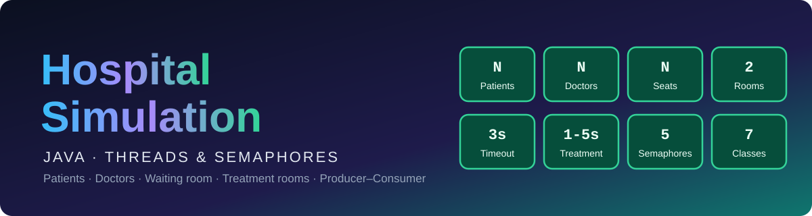
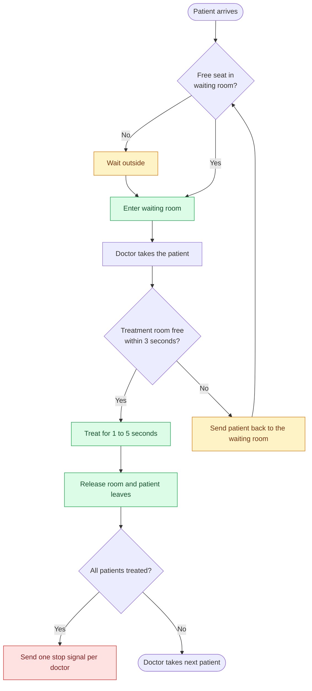
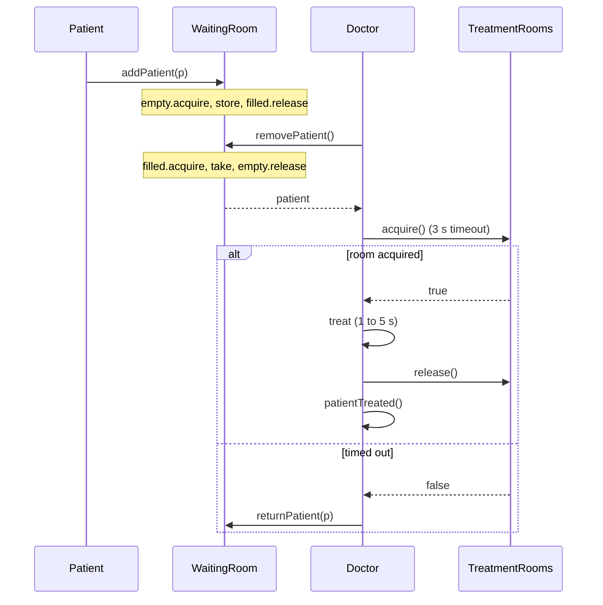

<div align="center">



<br/>


**A multi-threaded Java simulation of a hospital. Patients arrive, wait in a bounded waiting room, and doctors treat them in a limited number of treatment rooms. All synchronization is built on a custom `Semaphore`.**

[Overview](#-overview) · [Class diagram](#-class-diagram) · [How it works](#-how-it-works) · [Structure](#-project-structure) · [Quick start](#-quick-start) · [Components](#-components) · [Limitations](#-known-limitations) · [Team](#-team)

</div>

---

## 🎯 Overview

The program simulates a small hospital with three shared resources:

| Resource | Meaning | Limit |
|---|---|---|
| 🪑 **Waiting room** | A bounded circular buffer of patients | Chosen by the user |
| 🩺 **Doctors** | Consumer threads that take patients from the waiting room | Chosen by the user |
| 🛏️ **Treatment rooms** | A shared pool a doctor must hold while treating | 2 rooms, 3 second timeout |

Every **patient** and every **doctor** is its own `Thread`. They coordinate only through semaphores, with no `synchronized` blocks except a small counter in `Hospital`.

### ✨ Features

| | |
|---|---|
| 🧵 **One thread per actor** | `Patient` and `Doctor` both extend `Thread` |
| 🔁 **Bounded buffer** | Circular array with `empty` and `filled` semaphores |
| 🔒 **Separate in/out locks** | `mutexIn` and `mutexOut` let producers and consumers work at the same time |
| ⏱️ **Timeout on rooms** | A doctor waits up to 3 seconds for a treatment room, then sends the patient back |
| 🚪 **Waiting outside** | If the waiting room is full, the patient waits outside until a seat is free |
| 🛑 **Clean shutdown** | Once everyone is treated, one stop signal (`null`) is sent per doctor |
| ⌨️ **Console input** | Capacity, number of doctors and number of patients are read at start |

---

## 🧩 Class Diagram


---

## 🧠 How it works

### Patient and doctor flow



### Interaction between threads



### 🔐 Synchronization design

| Semaphore | Where | Initial value | Purpose |
|---|---|:---:|---|
| `empty` | `WaitingRoom` | `size` | Counts free seats. Blocks patients when full |
| `filled` | `WaitingRoom` | `0` | Counts waiting patients. Blocks doctors when empty |
| `mutexIn` | `WaitingRoom` | `1` | Protects the `input` index (producers) |
| `mutexOut` | `WaitingRoom` | `1` | Protects the `output` index (consumers) |
| `rooms` | `TreatmentRooms` | `2` | Limits how many doctors treat at once |

**Why two mutexes?** Producers only touch `input` and consumers only touch `output`, so they never fight over the same variable. Using two locks lets a patient enter while a doctor takes another patient.

**Why does a doctor release the seat early?** `removePatient()` calls `empty.release()` right after taking the patient, so the seat is free as soon as the patient leaves the waiting room, not when the treatment ends.

**How does shutdown work?** `Hospital.patientTreated()` counts finished patients inside a `synchronized` block. When the count reaches `totalPatients`, it sends one `null` (stop signal) per doctor through `WaitingRoom.addStopSignal()`. Each doctor reads `null` and exits its loop.

---

## 🗂️ Project Structure

```text
Hospital-Simulation/
├── README.md
├── class_diagram.png
├── assets/
│   └── team.svg
└── src/
    ├── Main.java
    ├── Hospital.java
    ├── WaitingRoom.java
    ├── TreatmentRooms.java
    ├── Semaphore.java
    ├── Doctor.java
    └── Patient.java
```

> [!NOTE]
> `Semaphore` is our own class (with `acquire()`, `acquire(timeout)`, `tryAcquire()` and `release()`). It is **not** `java.util.concurrent.Semaphore`, so all files must be compiled together in the same package.

---

## 🚀 Quick start

**Requirements:** JDK 8 or newer.

```bash
cd src
javac *.java
java Main
```

### Example input

```text
Waiting room capacity: 3
Number of doctors: 2
Number of patients: 5
```

### Example output

> The exact order changes between runs, because treatment times are random and threads run in parallel.

```text
Patients arriving:
P1 P2 P3 P4 P5

P1 arrived.
P1 entered the waiting room.
P2 arrived.
P2 entered the waiting room.
Doctor 1 is assigned to P1.
Doctor 1 is trying to acquire a treatment room.
Doctor 1 acquired a treatment room.
Doctor 1 begins treating P1.
...
Doctor 1 finished treating P1.
Doctor 1 released the treatment room.
Doctor 1 is now available.
P1 left.
Completed patients: 1/5
...
All patients have been treated.
Simulation completed.
```

---

## 📦 Components

| Class | Type | Responsibility |
|---|---|---|
| 🚀 `Main` | Entry point | Creates a `Hospital` and calls `run()` |
| 🏥 `Hospital` | Coordinator | Reads input, builds everything, starts threads, tracks completed patients, sends stop signals |
| 🪑 `WaitingRoom` | Shared resource | Bounded circular buffer of `Patient` objects |
| 🛏️ `TreatmentRooms` | Shared resource | Wraps a semaphore of rooms with a timeout |
| 🚦 `Semaphore` | Utility | Custom counting semaphore |
| 🩺 `Doctor` | `Thread` | Takes patients, acquires a room, treats, or sends the patient back |
| 🧑‍🦽 `Patient` | `Thread` | Arrives at the hospital and enters the waiting room |

<details>
<summary><b>📚 API: Hospital</b></summary>

<br/>

| Method | Returns | Description |
|---|:---:|---|
| `run()` | `void` | Reads the three inputs from the console, then runs the simulation |
| `run(size, doctors, patients)` | `void` | Runs the simulation with given values. Prints `Invalid input.` on bad values |
| `patientArrived(Patient p)` | `void` | Forwards the patient to the waiting room |
| `getNextPatient()` | `Patient` | Blocks until a patient is available. `null` means stop |
| `returnPatient(Patient p)` | `void` | Puts the patient back into the waiting room |
| `acquireTreatmentRoom()` | `boolean` | `true` if a room was acquired within the timeout |
| `releaseTreatmentRoom()` | `void` | Frees a treatment room |
| `patientTreated()` | `void` | Increments the counter and starts shutdown after the last patient |
| `waitForDoctors()` | `void` | Joins all doctor threads |

</details>

<details>
<summary><b>📚 API: WaitingRoom</b></summary>

<br/>

| Method | Returns | Description |
|---|:---:|---|
| `WaitingRoom(int size)` | | Throws `IllegalArgumentException` if `size <= 0` |
| `addPatient(Patient p)` | `void` | A new patient arrives and enters, or waits outside if full |
| `returnPatient(Patient p)` | `void` | A patient sent back by a doctor enters again |
| `removePatient()` | `Patient` | Takes the next patient. `null` is a stop signal |
| `addStopSignal()` | `void` | Inserts a `null` so one doctor can stop |

</details>

<details>
<summary><b>⚙️ Simulation settings</b></summary>

<br/>

| Setting | Value | Where |
|---|:---:|---|
| Waiting room capacity | user input | `Hospital.run()` |
| Number of doctors | user input | `Hospital.run()` |
| Number of patients | user input | `Hospital.run()` |
| Treatment rooms | `2` | `Hospital.setup()` |
| Room acquire timeout | `3000 ms` | `Hospital.setup()` |
| Treatment duration | `1000 to 5000 ms` (random) | `Doctor.run()` |
| Patient names and ages | `P1, P2, ...` and `20 + i` | `Hospital.setup()` |

</details>

---

## ⚠️ Known limitations

<details>
<summary><b>Click to expand</b></summary>

<br/>

- **Possible deadlock when the waiting room is full:** if every doctor is trying to send a patient back while all seats are taken, nobody is left to take patients out, so everyone waits forever. A larger waiting room or fewer doctors than seats avoids it.
- **Hard-coded rooms:** the number of treatment rooms (2) and the timeout (3 seconds) are fixed in `Hospital.setup()`.
- **Single run:** the program reads input once and finishes. There is no repeat menu.
- **Generated data:** patient names and ages are generated, not entered by the user.

</details>

---

## 🛣️ Possible improvements

- [ ] Read the number of treatment rooms and the timeout from the user
- [ ] Avoid the full-waiting-room deadlock (for example a timeout when returning a patient)
- [ ] Add priorities, so urgent patients are treated first
- [ ] Add a small GUI (`run(size, doctors, patients)` is already GUI-ready)
- [ ] Add statistics: average waiting time and number of patients sent back

---

## 👥 Team

<div align="center">


<br/>

<sub><i>Learning concurrency by building it together.</i></sub>

</div>
